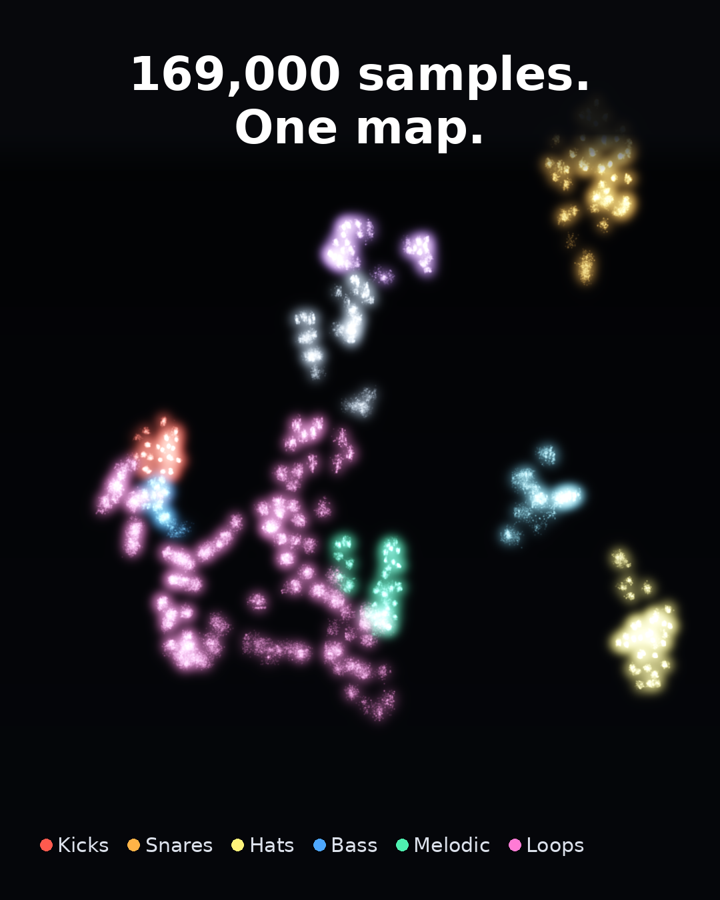
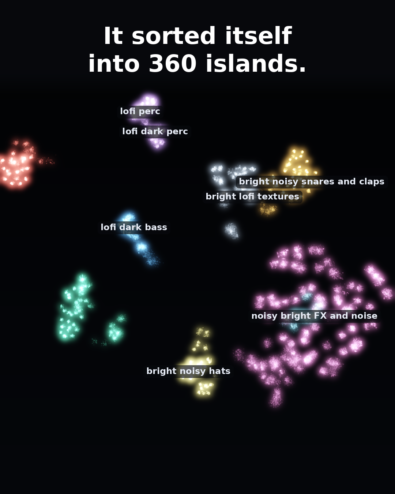

# soundlab

Your whole sample library on one 3D map. soundlab listens to every sample you
own, measures how it sounds, and lays them all out so similar sounds sit
together. Hover to hear, click to find the closest matches, drop favorites in a
cart, and build kits and songs in REAPER from what you find.



It runs on your own machine, on your own files. Nothing is uploaded.

## What you get

| Tool | What it does |
|---|---|
| **Library builder** | Catalogs every sample in your folders (type, pack, drum machine, tempo and key from the file names) and makes browse folders for REAPER's Media Explorer out of hard links, so they take no extra disk space. |
| **Analyzer** | Measures every sound: tempo, key, note, brightness, punch, low end, stereo width, noise, attack. Guesses what it is (kick, hat, loop, bass...) and tags its character (dark, lofi, punchy...). Resumable, uses all your CPU cores. |
| **Sound Galaxy** | Every sample as a point in 3D. Similar sounds form named islands ("lofi dark loops"), each sound type can get its own mini galaxy side by side, or pick your own axes. Hover to hear and see the waveform. Click for a web to the 14 closest sounds. Drift from sound to sound. Match key and tempo. Build a kit around one sound. Find duplicate files and gaps in your collection. |
| **Used vs owned** | Reads your REAPER projects and lights up the sounds you have actually used. Most producers reach for a tiny slice of what they own; the rest of the map shows what you paid for and never heard. Show only used or never-used sounds, see how much of each type you use, or press "Surprise me" to land on a random island you have never touched and build something from it. Set `project_folders` in soundlab.json if your projects live elsewhere. |
| **Cart** | Shift+click (or Cart mode, key C) drops sounds you like into a cart while you explore. It is remembered between visits. Save it, then lay it out in REAPER or get a Cart folder for the Media Explorer. |
| **Kit Builder** (REAPER) | Turns a saved kit into a 32 bar song: intro, verses, hook, outro, in one of four grooves (boom bap, house, electro, half-time), loops stretched to one tempo, a starting mix. |
| **Project audit and upgrade** (REAPER) | Reads your REAPER projects, flags loops stretched far from their tempo, and adds two library alternatives to every sample as extra takes (select an item, press T to flip). Your originals are never overwritten. |
| **Mix Check** | A report for any song: loudness (BS.1770), true peak, punch, loudness range, low end in mono, stereo width, tonal balance against your reference tracks, and kick and bass clash, with a spinnable 3D spectrogram. |

## Quick start (about 5 minutes plus measuring time)

You need [Python 3](https://www.python.org/downloads/) and, for the song tools, [REAPER](https://www.reaper.fm/).

**Windows** (PowerShell, in the soundlab folder):
```powershell
powershell -ExecutionPolicy Bypass -File .\Setup.ps1 -Samples "D:\Samples"
py soundlab.py all
```

**Mac or Linux:**
```bash
./setup.sh ~/Music/Samples
python3 soundlab.py all
```

`all` builds the library, measures every sound, makes the waveforms and opens
the Galaxy in your browser. Measuring runs at roughly 50 to 100 sounds per second
on a modern laptop (about 30 minutes for 170,000 samples). Stop it any time and
run it again; it continues where it left off.

Have samples in more than one place? Open `soundlab.json` and add them:
```json
"sample_folders": [
  { "name": "Drum packs", "path": "D:/Samples/Drums" },
  { "name": "Splice",     "path": "~/Splice/sounds" }
]
```

## Everyday commands

```
python soundlab.py build                 after adding new packs
python soundlab.py analyze               measures only the new sounds
python soundlab.py galaxy                refresh and open the Galaxy (add --waveforms after new packs)
python soundlab.py check song.wav        mix report (add --refs myrefs to compare against songs you like)
python soundlab.py audit                 check your REAPER projects and find alternatives
python soundlab.py cart                  newest saved cart -> a Cart folder for REAPER's Media Explorer
```

## In REAPER

Load these with **Actions > New action > Load ReaScript**. They find your folders
through `reaper/soundlab_paths.lua`, which setup writes from `soundlab.json`.

| Script | Use |
|---|---|
| `reaper/Soundlab_Kit_Builder.lua` | Build a song from the newest kit saved in the Galaxy |
| `reaper/Soundlab_Build_All_Kits.lua` | Build every kit in `<projects>/kits`, one tab each |
| `reaper/Soundlab_Cart_To_Project.lua` | Lay out your saved cart on tracks grouped by type |
| `reaper/Soundlab_Upgrade_Project.lua` | Add library alternatives to every sample as takes (run `audit` first) |

## Galaxy keys

| | |
|---|---|
| Hover | hear it, see its waveform |
| Click | select it: closest matches, island, copies, kit ideas |
| Shift+click, or C for Cart mode | add to cart |
| Space | play or stop |
| Esc | clear the selection |

## Examples

`examples/` holds tools built around specific commercial packs. They show what
you can do with the pieces above; they need those packs to run.

| Example | Needs |
|---|---|
| `machine_tour/make_kits.py`: eight songs, one per classic drum machine | Samples From Mars machine packs |
| `mars_remix/remix_projects.py`: rebuild your songs' drums from Mars, re-timing every chop | Samples From Mars |
| `stoner_doom/Soundlab_Doom.lua`: six varispeed doom songs | LoudFoundry Stoner Doom Rock pack |
| `galaxy_demo/make_demo.py`: the vertical video and photos below | ffmpeg, Pillow, sounds of your choice |

## Privacy and licenses

Your settings, catalog, measurements, Galaxy data, reference tracks and reports
stay on your machine; `.gitignore` keeps them out of git. Sample packs are
usually licensed for making music, not for sharing, so never commit audio.

The Galaxy and Mix Check pages load [three.js](https://threejs.org/) (MIT) from
a CDN, so the first open needs internet.


